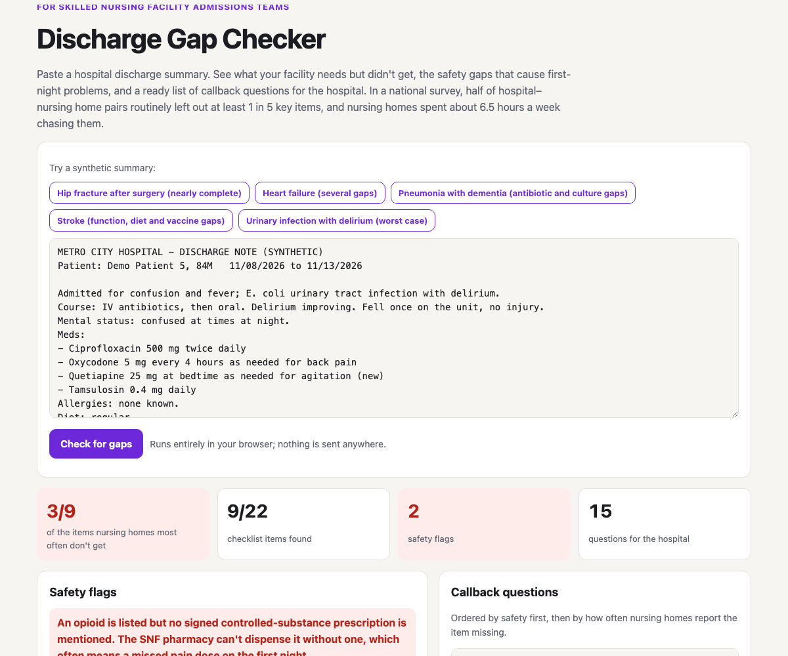

# Discharge Gap Checker

**Live: https://discharge-gap.vercel.app**

Paste a hospital discharge summary. The checker shows:
- what a skilled nursing facility (SNF) needs but didn't get;
- the safety gaps that cause first-night problems;
- a ready list of **callback questions** for the hospital.

**Who feels the pain:** SNF admissions nurses and Directors of Nursing. In a national
survey:
- half of hospital–SNF pairs routinely left out more than 1 in 5 key information types;
- only 11% received all of them;
- SNFs spent about 6.5 hours a week chasing the missing information.

**Who would pay:** SNF chains and post-acute networks, hospitals measured on readmissions,
and accountable care organisations.

## The evidence behind the checklist

Adler-Milstein J, Raphael K, O'Malley TA, Cross DA.
[Information Sharing Practices Between US Hospitals and Skilled Nursing Facilities to Support Care Transitions](https://jamanetwork.com/journals/jamanetworkopen/fullarticle/2775075).
*JAMA Netw Open.* 2021;4(1):e2033980. The study surveyed SNF Directors of Nursing,
covering 471 hospital–SNF pairs.

Information types most often **not** received:

| Item | Missing in |
|---|---|
| Behavioral status | 67.7% |
| Social status | 65.7% |
| Hospital contact for after-hours questions | 53.9% |
| Mental status | 44.1% |
| Immunization history | 40.7% |
| Functional status | 35.8% |
| Pending test results | about 30%* |
| Discharging physician contact | about 24%* |
| Code status / advance care plan | about 21%* |

\* Read from Figure 2B. The article text says only "at least 20%". The full 23-item list
is in the study's supplement, which I couldn't access, so the checklist adds 13 standard
transition-of-care items. These include medication changes, the time of the last doses,
allergies, diet and swallowing, wounds, devices, isolation status and follow-up, and the
app labels them as standard practice, not study findings.

## Safety flags

These are the gaps that turn into problems on the first night:

| Flag | Why it matters |
|---|---|
| **An opioid with no signed controlled-substance prescription** | The facility pharmacy can't dispense it, so the patient misses pain doses. |
| **An antibiotic with no stop date or duration** | Nobody knows when to stop it. |
| **An anticoagulant with no indication, duration or INR plan** | Dosing and monitoring are guesswork. |
| **Insulin with no doses or glucose-monitoring orders** | Glucose isn't checked or corrected safely. |
| **A pending result with nobody named to follow it up** | The result can get lost after discharge. |

## Synthetic test summaries

There are five summaries, each with gaps planted on purpose. The checker finds every
planted gap:

| Summary | Planted gaps | Result |
|---|---|---|
| Hip fracture (nearly complete) | social status | 8/9 study items found |
| Heart failure | behavior, code status, after-hours contact, vaccines, last doses | all flagged, plus a missing physician phone number |
| Pneumonia with dementia | antibiotic stop date, pending culture with no owner, contacts | both safety flags raised |
| Stroke | function, diet/swallowing, vaccines, social | all flagged |
| UTI with delirium (worst case) | opioid with no prescription, and most of the checklist | 3/9 study items, 2 safety flags, 15 questions |

## How it works

It is a static site (`index.html`, `app.js`, `data.js`, `samples.js`, `style.css`).
Each checklist item has a few word patterns. If none of them match, the item is
missing, and its question goes on the callback list. The list puts safety flags first,
then the other items in order of how often the study found them missing.

Nothing is sent anywhere. Use synthetic text only.

Pattern matching can miss information written in an unusual way, or count a passing
mention as present. The tool is a second pair of eyes, not a replacement for reading
the summary.

## Next

- Show it to SNF admissions nurses and Directors of Nursing, and to
  [LeadingAge CAST](https://leadingage.org/cast/), which helped guide the study.
- Optional AI extraction for free-text summaries, with the same "evidence or it doesn't
  count" rule.
- A shared, structured "SNF-ready" discharge template that hospitals could fill in.

Not a medical device. Built as part of a personal "vibe coding" practice roadmap
(Real problems track, #1).
